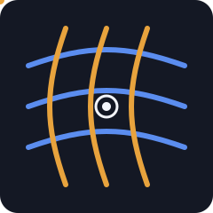

<p align="center">
  
</p>

# SignalWeave

Every AI framework emits telemetry in its own shape. LangChain calls it `lc_run_id` and `latency_ms`; an OpenTelemetry span calls it `trace_id` and `start_time`; a graph runner calls it `session` and `elapsed_ms`. SignalWeave reads those heterogeneous events and weaves them onto one canonical `Signal`, then groups signals by run and reports reliability, quality, and cost indicators. Nothing is dropped: an unrecognized shape falls through to a permissive generic adapter.

It runs on the Python standard library only, reads from a file or stdin, and writes to stdout, so it drops into a shell pipeline without ceremony.

## Pipeline


Four stages, each a subcommand:

```bash
# Canonical signals, one JSON object per line.
python -m signalweave normalize examples/events.jsonl

# Group into runs and emit the aggregate JSON.
python -m signalweave aggregate examples/events.jsonl

# Full weave report (text by default, or --format json).
python -m signalweave report examples/events.jsonl

# Everything for one run, in detail.
python -m signalweave inspect examples/events.jsonl --run-id run-gamma
```

Input is either a JSON array of event objects or newline-delimited JSON (JSONL). Pass `-` (or omit the path) to read stdin, which lets you chain stages or pipe from another tool.

## How normalization works

`normalize.py` detects a source family per event, either from an explicit `source` or `vendor` field or from structural fingerprints (`span_kind` points to OpenTelemetry, `lc_run_id` to LangChain, `graph_node` to a graph runner, `tool_name` plus `invocation_type` to an agent toolkit). Each family has a small adapter that maps its field names onto the canonical model; anything unmatched uses `_adapter_generic`.

The canonical `Signal` is flat and serializes to compact, diff-friendly JSON:

| Field | Meaning |
|-------|---------|
| `signal_id` | Deterministic `sig_<hash>` from run, name, timestamp, ordinal |
| `run_id` | The workflow run this signal belongs to |
| `kind` | `invocation`, `tool`, `retrieval`, `evaluation`, `error`, or `lifecycle` |
| `name` | Step name (node, tool, operation) |
| `ts` | Epoch milliseconds, coerced from seconds, ISO-8601, or raw numbers |
| `duration_ms` | Wall-clock duration |
| `severity` | `ok`, `notice`, `warn`, `error`, `critical` |
| `quality` | Clamped 0..1 score when present, else null |
| `tokens_in` / `tokens_out` | Token counts |
| `source` | Detected vendor family |
| `attributes` | Passthrough of vendor-specific fields |

`SignalKind.coerce` and `Severity.coerce` map common vendor vocabularies onto the canonical enums (for example `llm`, `chat`, and `completion` all become `invocation`; `warning` becomes `warn`). The full field reference lives in [docs/SCHEMA.md](docs/SCHEMA.md).

Normalization is deterministic: `normalize_stream` sorts by `(ts, run_id, name, signal_id)`, so the same input always yields the same output regardless of arrival order.
